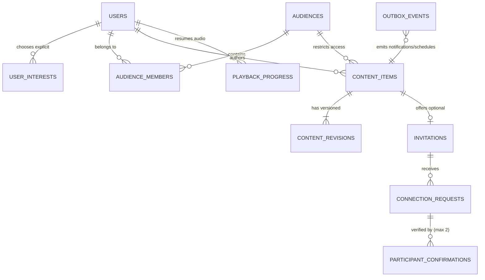
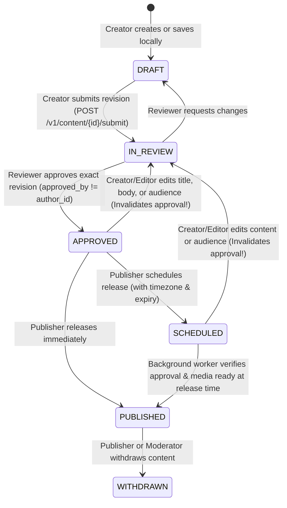
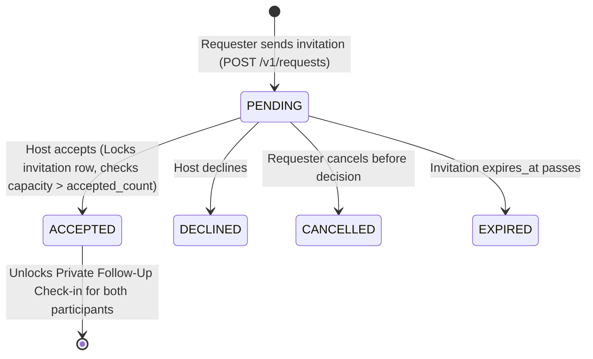

# Mastek Pulse — AI-DLC Phase 2: Domain Model, State Machines, and API Contracts

> **🎓 Intern & AI Agent Guide:**
> In AI-DLC, this file is our **Contract Specification**. Why is this the most important file in the repository?
> Because Developer A (using Claude Code on Java Spring Boot), Developer B (using GitHub Copilot on React Web), and Developer C (using Codex on React Native) will all generate code from the **exact table definitions, state machines, and HTTP response codes** defined here.
> **Rule:** Never invent a new status name, database column, or HTTP status code without updating this file first!

---

## 1. Core Database Schema & Minimum Contracts (PostgreSQL 16)

> **🎓 Intern Tip — Why do we separate `content_items` and `content_revisions`?**
> Imagine Daniel publishes Revision 1 of his story. It is live for employees to read. Tomorrow, Daniel wants to fix a typo or update his story, creating Revision 2. While Revision 2 is waiting for a Reviewer to approve it (`IN_REVIEW`), Revision 1 remains safely published! Plus, as Page 11 & 15 of our proposal mandate: *"Approvals bind to a revision. Any content or audience edit invalidates approval and returns the new revision to review."*

### Entity-Relationship Diagram (ERD)


### Key Records & Minimum Contract Table (From Proposal Page 15)

| Record / Table | Primary Fields & Types | Constraints & Business Rules |
| :--- | :--- | :--- |
| **`users`** | `id` (VARCHAR PK), `display_name`, `email`, `region` (`INDIA`, `UK`, `US`), `function_name`, `roles` (TEXT[]), `host_paused` (BOOLEAN) | Synthetic profiles in POC; no private messages or appraisal scores stored. |
| **`audiences`** | `id` (VARCHAR PK), `name`, `description`, `region_filter` | Every content item and audio stream is filtered by `audience_id` *before* ranking. |
| **`content_items`** | `id` (UUID PK), `author_id` (FK), `audience_id` (FK), `content_type` (`STORY`, `UPDATE`, `CULTURE_CAST`, `RADIO_QUEUE`), `current_version` (INT), `published_version` (INT NULL), `status` | `status` IN (`DRAFT`, `IN_REVIEW`, `APPROVED`, `SCHEDULED`, `PUBLISHED`, `WITHDRAWN`). |
| **`content_revisions`** | `id` (UUID PK), `content_id` (FK), `version_number` (INT), `title`, `summary`, `body_text`, `media_asset_id` (FK NULL), `transcript_text`, `duration_seconds`, `chapters_json`, `approved_by` (FK NULL), `approved_at` | `UNIQUE(content_id, version_number)`. **Self-approval check:** `approved_by <> author_id`. |
| **`invitations`** | `id` (UUID PK), `story_id` (FK UNIQUE), `host_id` (FK), `topic_label`, `duration_minutes` (DEFAULT 15), `capacity` (INT), `accepted_count` (INT DEFAULT 0), `paused` (BOOLEAN DEFAULT FALSE), `expires_at` (TIMESTAMPTZ) | `CHECK (accepted_count <= capacity)`. Disabled when `paused = true`, `accepted_count >= capacity`, or `now() >= expires_at`. |
| **`connection_requests`** | `id` (UUID PK), `invitation_id` (FK), `requester_id` (FK), `message_text`, `ai_assisted` (BOOLEAN), `idempotency_key` (VARCHAR), `state`, `version` (INT DEFAULT 1) | `UNIQUE(invitation_id, requester_id)`. `UNIQUE(requester_id, idempotency_key)`. `state` IN (`PENDING`, `ACCEPTED`, `DECLINED`, `CANCELLED`, `EXPIRED`). |
| **`participant_confirmations`** | `id` (UUID PK), `request_id` (FK), `user_id` (FK), `happened` (VARCHAR: `YES`, `NO`, `NOT_YET`), `useful` (BOOLEAN NULL), `updated_at` | `UNIQUE(request_id, user_id)`. Only the 2 participants (`requester_id` and `host_id`) can insert/read rows for a `request_id`. |
| **`playback_progress`** | `user_id` (FK), `content_id` (FK), `position_seconds` (INT), `duration_seconds` (INT), `updated_at` | `PRIMARY KEY (user_id, content_id)`. Enables seamless Desktop Web <-> Mobile commute resume. |
| **`outbox_events`** | `event_id` (UUID PK), `aggregate_type`, `aggregate_id`, `event_type`, `payload_json` (JSONB), `attempts` (INT DEFAULT 0), `next_run` (TIMESTAMPTZ), `status` (`PENDING`, `PROCESSED`, `FAILED`) | Written in the **exact same DB transaction** as domain mutations (`ACCEPT`, `PUBLISH`, `SCHEDULE`). |

---

## 2. Explicit State Machines

### A. Editorial & Publishing State Machine (`content_items.status`)


### B. Connection Request State Machine (`connection_requests.state`)


> **🎓 Intern Tip — How do we calculate a "Useful Connection"?**
> Look at Page 8, 12, and 15 of the proposal:
> - After a request reaches `ACCEPTED`, both the Requester (Asha) and the Host (Daniel) can submit a `participant_confirmations` record.
> - **Rule:** A connection is counted as **Useful** in pilot metrics **ONLY** when:
>   `Asha.happened == 'YES' AND Asha.useful == true` **AND** `Daniel.happened == 'YES' AND Daniel.useful == true`.
> - If either person skips feedback or selects `NOT_YET`, the outcome remains `UNKNOWN` (never assumed positive or negative).

---

## 3. The "Accept Flow / One Transaction" Algorithm (Proposal Page 15)

When a Host clicks **Accept** on a connection request (`PATCH /v1/requests/{id}`), our Java Spring Boot service **must** execute these exact 4 steps inside a single `@Transactional` boundary:

```java
// Conceptual Java 21 + Spring Boot pattern for Interns & AI Agents:
@Transactional
public ConnectionRequestDto acceptRequest(UUID requestId, int expectedVersion, UserPrincipal currentHost) {
    // STEP 1: Authenticate host and re-check audience, invitation expiry, and request ownership
    ConnectionRequest req = requestRepo.findById(requestId)
        .orElseThrow(() -> new ResourceNotFoundException("Request not found"));

    // STEP 2: Lock the invitation row using Pessimistic Write (SELECT ... FOR UPDATE)
    Invitation inv = invitationRepo.findByIdWithPessimisticLock(req.getInvitationId())
        .orElseThrow(() -> new ResourceNotFoundException("Invitation not found"));

    if (!inv.getHostId().equals(currentHost.id())) {
        throw new AccessDeniedException("403: Only the invitation host can accept this request");
    }
    if (req.getVersion() != expectedVersion || req.getState() != RequestState.PENDING) {
        throw new ConflictException("409: Stale request version or request is no longer PENDING");
    }
    if (inv.isPaused() || inv.getExpiresAt().isBefore(Instant.now())) {
        throw new ConflictException("409: Invitation is paused or expired");
    }
    if (inv.getAcceptedCount() >= inv.getCapacity()) {
        throw new ConflictException("409: Full capacity reached (" + inv.getCapacity() + " places filled)");
    }

    // STEP 3: Set accepted, increment accepted_count, and write an outbox event; commit together
    req.setState(RequestState.ACCEPTED);
    req.setVersion(req.getVersion() + 1);
    inv.setAcceptedCount(inv.getAcceptedCount() + 1);

    outboxRepo.save(OutboxEvent.create(
        "CONNECTION_REQUEST", req.getId(), "REQUEST_ACCEPTED",
        Map.of("requestId", req.getId(), "requesterId", req.getRequesterId(), "hostId", inv.getHostId())
    ));

    return mapper.toDto(req, inv);
}
// STEP 4: Background Worker picks up the OutboxEvent and delivers a generic notification.
```

---

## 4. REST API Endpoints & Standard HTTP Status Codes

All clients (Android, iOS, Employee Web, Publishing Portal) share `/api/v1`:

### Mandatory HTTP Status Codes (Proposal Page 15)
- `200 OK` / `201 Created`: Successful operation.
- `401 Unauthorized`: Invalid or expired authentication token/session.
- `403 Forbidden`: Authenticated user lacks role (`CREATOR`, `REVIEWER`, `PUBLISHER`, `MODERATOR`, `ADMIN`), violates self-approval (`approved_by == author_id`), or is excluded from the item's `audience_id`.
- `409 Conflict`:
  - Stale `version` number on a `PATCH` or review action.
  - Full host capacity (`accepted_count >= capacity`) or expired/paused invitation.
  - Editing a revision that is no longer editable.
- `422 Unprocessable Entity`: Schema validation failure (e.g., blank message, capacity < 1, missing required fields).

### Endpoint Summary Table

| Domain Module | Method & Path | Purpose & Key Contract Behavior |
| :--- | :--- | :--- |
| **Auth / Persona Switcher (POC)** | `GET /api/v1/me`<br>`POST /api/v1/auth/demo-switch` | Returns current authenticated user profile, explicit interests, audiences, and scoped roles. In POC mode, allows instant switching between Asha, Daniel, Priya, Marcus, and Elena to demo all journeys! |
| **Feed & Discovery** | `GET /api/v1/feed`<br>`GET /api/v1/stories/{id}` | **Filter -> Rank -> Explain:** First filters by user's `audience_id` permissions, then ranks by explicit `interests` and open invitation capacity, returning a factual `explanation` string (`"WHY THIS? Your interest: team learning"`). |
| **Listen (Radio & Culture Cast)** | `GET /api/v1/listen/radio`<br>`GET /api/v1/listen/culture-cast`<br>`PUT /api/v1/listen/progress` | Returns curated Mastek Radio queue and Culture Cast episodes with chapters, transcripts, related story links, and short-lived signed audio URLs. `PUT /progress` saves cross-device resume position. |
| **Connections & Feedback** | `POST /api/v1/requests`<br>`GET /api/v1/requests`<br>`PATCH /api/v1/requests/{id}`<br>`POST /api/v1/requests/{id}/confirmations` | `POST /requests` requires `Idempotency-Key` header so mobile retries never create duplicate requests. `PATCH` runs the 1-transaction locked Accept/Decline/Cancel flow. `POST /confirmations` saves bilateral private feedback. |
| **Publishing & Review Portal** | `POST /api/v1/content`<br>`PUT /api/v1/content/{id}/revisions`<br>`POST /api/v1/content/{id}/submit`<br>`POST /api/v1/content/{id}/review`<br>`POST /api/v1/content/{id}/publish`<br>`POST /api/v1/content/{id}/withdraw` | Implements `Draft > In review > Approved > Scheduled/Published > Withdrawn`. Enforces `REVIEWER` role (no self-approval) and `PUBLISHER` role. Any content/audience edit after approval creates a new revision in `IN_REVIEW`. |
| **AI Assistance & Budget Gate** | `POST /api/v1/ai/drafts`<br>`POST /api/v1/ai/summaries`<br>`GET /api/v1/ai/budget` | Checks the 720-action budget cap (50%/80%/100% alerts). Sends only permitted text. Always returns both `aiSuggestion` (labeled) and `templateFallback` so the UI works seamlessly even if AI is disabled or capped. |
